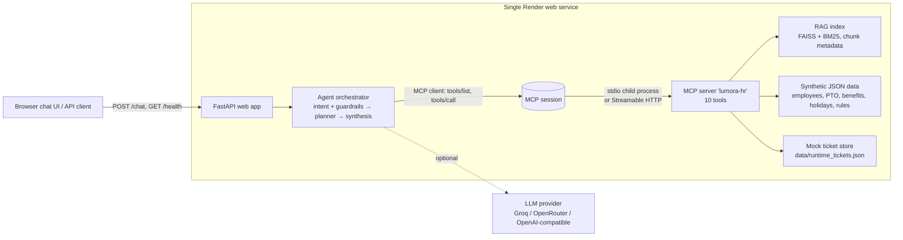

# Design and Evaluation — Lumora HR Agent

This document covers the architecture, the design choices and their rationale, the RAG, MCP and agent design, the safety guardrails, deployment and CI/CD, the two demo tasks, and the evaluation (questions, gold answers, metrics, results and ablations).

> Lumora Systems, Inc. and all policies, people and records are fictional and synthetic.

## 1. Architecture



Text version:

```
[UI / API client] → FastAPI (/chat, /health, /tools, /demo-tasks, /employees, /tickets)
      → Agent orchestrator
           1. NLU + guardrails  (intent, slots, sensitive / out-of-scope / privacy / vagueness)
           2. Router            (RAG-only policy Q&A  vs.  multi-step workflow)
           3. Workflow planner  → MCP client ──(stdio | Streamable HTTP)──► MCP server "lumora-hr"
                                                                       ├─ RAG tools  → FAISS + BM25 index (rag/)
                                                                       ├─ data tools → mock_data/*.json
                                                                       └─ mock actions → data/runtime_tickets.json
           4. Synthesis         (LLM grounded rewrite, or deterministic template) + citation verification
           5. Response          answer, citations + snippets, trace, escalation, pending_action, latency
      LLM provider (optional, env-configured)
```

**Single-service deployment.** The web app, orchestrator, MCP client, MCP server (spawned as a stdio child process), FAISS index and synthetic data all run in one Render free web service. The MCP server can also run as a separate service over Streamable HTTP by setting `MCP_SERVER_URL`. This path is tested locally (`MCP_SERVER_URL=http://127.0.0.1:8765/mcp python scripts/mcp_smoke.py`).

## 2. Design choices (summary)

| Decision | Choice | Why |
|---|---|---|
| Agent framework | **Manual orchestration** (plain Python, ~700 lines) with an optional LLM function-calling (ReAct) mode | Full control over guardrails, confirmation gating and trace format. Deterministic and testable on free tiers. No framework lock-in or hidden prompts. Every step is an explicit MCP call that shows in the trace. |
| Planning | Intent router + **workflow plans** (templates of MCP calls with data-dependent branches) | HR workflows are well-defined. Deterministic plans make tool selection reliable (100% on the eval set) and auditable. The LLM is used where it adds most value: language understanding and answer synthesis. |
| MCP server | One server, `FastMCP` from the official `mcp` SDK (v1.30), 10 typed tools | One coherent HR domain. Typed Python signatures plus docstrings generate JSON Schemas automatically. |
| Transport | **stdio** by default; **Streamable HTTP** optional | stdio needs no extra port or service and fits a single free-tier service. Streamable HTTP is the standard remote transport for a separate MCP service. |
| Tool schemas | Small, explicit arguments (`employee_id`, `request_type`, `details`); structured JSON results with `ref` citations and error objects | Easy for an LLM or planner to fill. Results carry policy references, so tool facts are citable. |
| Embedding model | **BAAI/bge-small-en-v1.5** via `fastembed` (local ONNX, 384-d, free) in deployment; **LSA** (TF-IDF 1–2-grams + SVD, seed 42) as offline fallback for CI | No API key or cost; runs within 512 MB. LSA keeps CI deterministic and works where model downloads are blocked. |
| Chunking | **Heading-aware**: one chunk per numbered policy section, split into 220-word windows with 40-word overlap only when longer, with a contextual header (`POL-002 Paid Time Off Policy > 6.2 Advance notice requirements`) prepended for embedding | Policy sections are the natural unit of meaning *and* of citation, so a chunk never spans two sections and every citation maps to one section. Headers give short sections topical context. |
| Retrieval | Top-k = 5, **hybrid** (dense FAISS + BM25 fused with reciprocal rank fusion), lexical **rerank**, domain **query rewriting**, optional `doc_ids` filter | Hybrid catches exact policy terms (e.g. "401(k)", "I-9") and paraphrases. Rerank and rewrite improved citation accuracy from 91.7% to 100% (ablation §9.5). k = 5 saturates quality at low latency (ablation §9.4). |
| Vector store | **FAISS `IndexFlatIP`** + `chunks.jsonl` metadata + `manifest.json`, built at deploy time | About 250 vectors: exact search is instant, there is no server and no paid database, and the index is rebuilt reproducibly from the committed corpus. |
| Evidence guardrail | **idf-weighted evidence coverage** of the question's content terms in retrieved passages, minimum 0.5 | Simple and explainable. Cleanly separates in-corpus questions (≥0.59) from out-of-corpus ones like pets, dress code or smoking (≤0.34). |
| LLM | Groq `llama-3.3-70b-versatile` (free tier) through an OpenAI-compatible client; temperature 0, seed 42 | Free and fast, with function-calling support. Swappable via env (OpenRouter, OpenAI, any compatible endpoint). |
| Web framework | FastAPI + one static HTML/JS file | Async (good fit for the async MCP client), automatic `/docs`, no build step. |
| Deployment | Render free web service (native Python) from `render.yaml`; `Dockerfile` for Railway or other hosts | Meets the free-tier requirement. The index and model are built during the build step. |

## 3. Corpus and synthetic data

**Policy corpus (13 documents, 4 formats, about 16,200 words, about 32 pages at roughly 500 words per page):**

| ID | Title | Format |
|---|---|---|
| POL-001 | Code of Conduct and Workplace Behavior Policy | Markdown |
| POL-002 | Paid Time Off (PTO) Policy | Markdown |
| POL-003 | Holiday Calendar and Floating Holiday Policy 2026 | HTML |
| POL-004 | Remote and Hybrid Work Policy | Markdown |
| POL-005 | International and Cross-Border Work Policy | Markdown |
| POL-006 | Travel and Expense Reimbursement Policy | Markdown |
| POL-007 | Information Security and Acceptable Use Policy | HTML |
| POL-008 | Benefits Overview | Markdown |
| POL-009 | Leave of Absence Policy | TXT |
| POL-010 | Onboarding and Offboarding Procedures | Markdown |
| POL-011 | Equipment and Home Office Policy | PDF (rendered from `corpus_src/`) |
| POL-012 | HR Case Handling and Escalation Procedure | Markdown |
| POL-013 | Payroll, Compensation, and Performance FAQ | TXT |

The documents cross-reference each other on purpose (for example, remote work → cross-border work → security → expenses), so multi-document questions are realistic. All documents were authored with AI assistance for this project and are clearly labelled as synthetic.

**Mock structured data (`mock_data/`):** 21 synthetic employees with varied profiles (full-time, part-time at 0.6 FTE, contractor, intern, pre-boarding new hire; US, Canada, UK; onsite, hybrid, remote; one on a PIP; Internal, Confidential and Restricted data access), PTO balances, benefits elections, offices, 2026 holiday calendars, seed HR tickets, and `policy_rules.json`. The last file holds machine-readable numeric policy parameters, each with its source citation; the compliance tool uses them.

## 4. RAG design

**Ingestion (`rag/parsers.py`, `rag/ingest.py`).** Format-specific parsers produce `Section(doc_id, title, section_id, section_title, parent, text, source_file, source_format)`:
- Markdown: `##`/`###` headings, numbered (`6.2 Advance notice requirements` → `section_id=6.2`).
- HTML (BeautifulSoup): `nav`, `header`, `script` and `style` are removed; `h2`/`h3` become sections; table rows become `cell | cell`.
- TXT: upper-case numbered headings (`7. BEREAVEMENT LEAVE`) plus `7.1 …` paragraph subsections.
- PDF (pypdf): text extraction plus numbered-heading detection.

Cleaning normalizes whitespace and quotes and drops the synthetic-data disclaimer lines. Titles come from `corpus/catalog.json`.

**Chunking (`rag/chunker.py`).** Heading-aware, deterministic, with stable chunk IDs (`POL-005::7::0`). The configuration produces 234 chunks. Because the policy sections are short, the section boundary does most of the work (see the chunk-size ablation in §9.5).

**Embeddings and store.** See §2. `manifest.json` records the provider, model, dimension, chunk parameters, corpus fingerprint and seed. At query time the same embedder that built the index is loaded, which keeps the index and queries compatible.

**Retrieval (`rag/retriever.py`).**
1. **Query rewriting** expands employee vocabulary into policy vocabulary (for example "vacation" → "PTO paid time off"; "Portugal/abroad" → "international temporary remote work … allowance").
2. Dense top-N from FAISS and BM25 top-N, fused with **reciprocal rank fusion**.
3. **Lexical rerank** of the fused pool by idf-weighted overlap with the original query, with expansion terms at half weight.
4. Optional `doc_ids` **filter**.
5. Return top-k with `citation` (`POL-005 §4.1`), title, section, scores, a query-focused **snippet** and the text.
6. Compute **evidence coverage**: the idf-weighted share of the question's content terms found in the returned passages, together with the uncovered terms.

**Prompting strategy (`agent/prompts.py`).** The synthesis prompt includes:
- the question and the acting employee;
- a **verified answer plan** built by the planner, which keeps all its citations;
- **evidence blocks** labelled `[POL-xxx §n] Title > Section` with passage text;
- compact JSON from the non-search tool results.

The rules: cite every policy statement with a label that appears in the evidence; use the fixed headings **Short answer / What the policy says / Your situation / Recommended next steps (recommendations, not policy) / Approvals needed**, which separate policy facts from recommendations; say so when the evidence is missing; give no legal, tax, medical or immigration advice; and never claim anything was submitted or sent.

**Multi-document questions.** Questions are split into sub-questions. Follow-up parts that depend on a pronoun inherit the first part's topic. Each sub-question is retrieved separately, and the system retries with a reformulated query if coverage is low. The best passage per sub-question is selected by sentence-level answer scoring. Example: *"I'm traveling to London for a client meeting: what's the nightly hotel limit, and do I need the VPN on hotel Wi-Fi?"* → POL-006 §6 ($350 high-cost city limit) + POL-007 §5 (VPN required on public Wi-Fi).

## 5. MCP server design (`mcp_server/`)

- **Implementation:** `FastMCP("lumora-hr")` from the official `mcp` Python SDK. Every tool is a typed Python function; its signature and docstring become the JSON Schema served by `tools/list` (exported to `mcp_server/tool_schemas.json`).
- **Transport:** stdio by default (the app's MCP client spawns `python -m mcp_server.server`), or `--transport streamable-http` (default `http://0.0.0.0:8765/mcp`).
- **Discovery and calls:** on start-up the agent's `MCPClientManager` runs `initialize`, then `tools/list`, and caches the schemas. `/tools` and `/health` expose them. Every tool invocation by the agent is an MCP `tools/call`; the orchestrator never imports the tool functions. Results are parsed from `structuredContent`, with a fallback to JSON text content.
- **Error model:** tools return structured errors (`{"error": "employee_not_found", "message": …}`). The client converts transport failures, timeouts, disabled tools and unknown tools into structured errors too, so the agent can degrade gracefully.

| Tool | Arguments | Returns | Kind |
|---|---|---|---|
| `search_policy_documents` | `query`, `k`=5, `doc_ids`? | hits with `citation`, title, section, snippet, text, scores; `evidence_coverage`, `uncovered_terms`, `rewritten_query` | RAG |
| `get_policy_section` | `doc_id`, `section_id`? | full text of a section and its subsections (or the section list) | RAG |
| `list_policy_documents` | – | documents, sections, index manifest | RAG |
| `lookup_employee_profile` | `employee_id`, `requester_id`? | profile, manager, tenure, rating, PIP, data access; **restricted directory view** unless requester is self or manager | data |
| `check_pto_balance` | `employee_id` | balance, entitlement, accrual, carryover, sick days, floating holidays, upcoming/pending PTO | data |
| `lookup_benefits_status` | `employee_id` | elections, enrollment status, open enrollment dates | data |
| `check_policy_compliance` | `employee_id`, `request_type` ∈ {`pto_request`, `temporary_remote_work`, `expense`, `benefits_eligibility`}, `details` | `verdict`, per-check `status` + `detail` + `ref` citation, required approvals, alternatives | data + rules |
| `create_mock_hr_ticket` | `employee_id`, `category`, `summary`, `severity`, `policy_refs`, `confirm`=false | **preview only** unless `confirm=true`; writes only to a local demo file | mock action |
| `draft_hr_email` | `employee_id`, `recipient`, `purpose`, `key_points` | draft (`status: draft_not_sent`) | mock action |
| `generate_onboarding_checklist` | `employee_id` | dated checklist with policy refs | data + rules |

Example schema (from `tools/list`):

```json
{"name": "check_policy_compliance",
 "input_schema": {"type": "object", "required": ["employee_id", "request_type"],
   "properties": {"employee_id": {"type": "string"}, "request_type": {"type": "string"},
                  "details": {"anyOf": [{"type": "object"}, {"type": "null"}], "default": null}}}}
```

## 6. Agent orchestration (`agent/orchestrator.py`)

1. **NLU and guardrails (`agent/nlu.py`).** Deterministic intent classification (`policy_qa`, `pto_request`, `remote_work`, `expense`, `benefits`, `onboarding`, `hr_case_sensitive`, `out_of_scope`) and slot extraction: dates such as "next week" or "Nov 2–4", durations such as "six weeks" (converted to 30 workdays), destination country or state, amount, and benefit. The rules are cheap, testable and always run, so safety decisions never depend on the LLM.
2. **Router, which decides whether RAG alone is sufficient.** General policy questions go to the RAG-only path (`search_policy_documents` per sub-question). Personal requests ("can I…", "my…") with a workflow intent go to a multi-step workflow that combines employee data, policy evidence and a compliance check. A personal workflow without an employee ID triggers clarification plus a general policy answer.
3. **Workflow plans.** Each plan is a sequence of MCP calls with data-dependent branches. For example, if the remote-work duration fails, the plan checks the PTO balance to see whether "allowance + PTO" is feasible, fetches the exception section, and prepares an escalation.
4. **Evidence check and citation self-verification.** Coverage below 0.5 leads to a refusal and redirect. Before answering, any cited section not already retrieved is fetched with `get_policy_section`. After synthesis, citations are validated against the retrieved and tool evidence, and unsupported citations are flagged in the response (`grounded=false`, `unsupported_citations`).
5. **Synthesis.** The LLM rewrites the verified plan when configured; otherwise a deterministic template is used.
6. **Trace.** Each step records `{step, type: intent|plan|tool_call|evidence_check|guardrail|clarification|escalation|llm|user_confirmation|final, …}`. Tool calls include the tool name, arguments, reason, status, result summary, size-bounded output and latency. The final step records the answer basis, synthesis mode, grounded flag and escalation decision. This is an operational trace, not chain-of-thought.
7. **ReAct mode (`AGENT_MODE=react`).** The LLM receives the MCP tool schemas as functions and chooses tools itself (up to 8 steps). Guardrails still apply: sensitive and out-of-scope requests are handled before the LLM, `confirm` is forced to false, the `employee_id` of data tools is overridden to the acting employee, and citations are validated.

**Failure handling:**

| Situation | Behavior |
|---|---|
| MCP server unavailable | Client tries to reconnect; tool returns `mcp_unavailable`; answer says the tool is unavailable and gives the People Team contact; `/health` returns 503 `degraded` |
| Tool disabled or unknown | Structured error, graceful message (see tool-availability ablation) |
| Missing or unknown employee ID | Clarification question plus general policy answer |
| Ambiguous request (no dates, destination or duration) | Clarifying question with the relevant facts (for example the current balance) |
| Incomplete policy evidence | Partial answer, with the unanswered sub-question named explicitly |
| No evidence | Refusal and redirect |
| Unexpected exception | Caught; apologetic fallback with contact details |

## 7. Safety guardrails

- **No irreversible actions.** Tickets are mock-only (local file, `MOCK-HR-…` IDs). `create_mock_hr_ticket` defaults to `confirm=false` and returns a preview. The agent surfaces a `pending_action`, and only an explicit user confirmation (UI button or `confirm_action` payload) executes it. Confirmable tools are on an allow-list, and the owner must match. Emails are drafts only and are never sent.
- **Sensitive cases (Severity 1).** Harassment, discrimination, retaliation, threats or self-harm are detected by rules and always escalated to Employee Relations with reporting channels and the non-retaliation policy. The assistant never investigates or judges these cases (POL-012 §6.2). Self-harm mentions get emergency, crisis-line and EAP information.
- **Out of scope.** Off-topic questions are refused without any tool calls. Out-of-corpus HR questions are refused when evidence coverage is below threshold.
- **Grounding.** Answers cite `POL-xxx §n`, citations are verified, and policy is separated from recommendations, which are labelled as such.
- **Privacy.** Profile requests carry `requester_id`; other employees' personal data is only shown to them or their manager. Data tools in ReAct mode are pinned to the acting employee.
- **No professional advice.** Legal, tax, medical and immigration advice is explicitly excluded.
- **Secrets** come only from environment variables. No real personal data exists anywhere in the system.

## 8. Deployment and CI/CD

- **Render** (`render.yaml`): one free web service, Python 3.13. The build step runs `pip install -r requirements.txt && python -m rag.ingest`, which builds the FAISS index and downloads bge-small once at build time. The service starts with `uvicorn app.main:app`, and the health check is `/health`. `autoDeploy: false` means only CI triggers deploys.
- **GitHub Actions** (`.github/workflows/ci.yml`), on push and pull request:
  1. install dependencies;
  2. import/build check;
  3. build the index (offline LSA);
  4. **MCP tool discovery + tool call smoke test** (`scripts/mcp_smoke.py`);
  5. **app start-up test** (uvicorn plus a `/health` assertion that MCP is connected);
  6. `pytest` (28 tests);
  7. quick evaluation, with results uploaded as an artifact;
  8. **deploy job** (`needs: test`, only on `main`), which calls the Render deploy hook and then polls `/health` on the deployed URL.

  If any test step fails, the deploy job never runs.
- **Cold starts:** see `deployed.md`. The free tier sleeps after about 15 minutes idle; the first request then takes roughly 30–60 seconds (platform boot, then MCP spawn and index/model load at about 1.4 s in-process). Warm requests take tens of milliseconds in offline mode, or about 1–3 seconds with LLM synthesis.

## 8.1 The two required demo tasks and their MCP call sequences

**Demo 1 — Remote work eligibility.** Priya Natarajan (E1001, Senior Software Engineer, hybrid, Austin TX): *"I want to work remotely from Portugal for six weeks starting in January. Am I allowed to do that, and what do I need to do?"*

| # | MCP tool | Key arguments | Result used |
|---|---|---|---|
| 1 | `lookup_employee_profile` | `employee_id=E1001, requester_id=E1001` | remote-eligible role, tenure 5.6 years, rating "Exceeds", Confidential access, US entity |
| 2 | `search_policy_documents` | `query="temporary remote work from another country allowance 20 workdays approvals notice", k=4, doc_ids=["POL-005"]` | POL-005 §4.1, §4.3, §7, … |
| 3 | `search_policy_documents` | `query="security requirements working abroad VPN managed device restricted data", k=2, doc_ids=["POL-007","POL-005"]` | POL-005 §6.x / POL-007 §5 |
| 4 | `check_policy_compliance` | `request_type="temporary_remote_work", details={destination_country:"Portugal", workdays:30, duration_weeks:6}` | verdict `not_compliant`: duration fails (30 > 20 workdays); destination, tenure, rating pass; approvals: Manager → Global Mobility → InfoSec |
| 5 | `get_policy_section` | `doc_id="POL-005", section_id="7"` | exact exception rules |
| 6 | `check_pto_balance` | `employee_id=E1001` | 12.83 days ≥ the 10 days beyond the allowance → "20 workdays + PTO" option is feasible |
| 7 | `draft_hr_email` | `recipient="manager", purpose="discuss working temporarily from Portugal …"` | draft to Daniel Okafor (not sent) |
| 8 | `create_mock_hr_ticket` | `category="work_arrangement", severity=2, confirm=false` | **preview only** → `pending_action` + escalation to Global Mobility |

**Final answer:** not as a standard request (exceeds the 20-workday rolling allowance, [POL-005 §4.1]). Option A is 20 workdays plus 10 days of PTO; option B is a Global Mobility exception [POL-005 §7]. Submit the form 30 days ahead [POL-005 §4.3]; use the VPN and a managed device; travel is not reimbursed. The answer includes a compliance table and an optional mock case that requires confirmation.

**Demo 2 — PTO request guidance.** Marcus Lee (E1002, Customer Support Specialist, Denver CO), on Friday 2026-10-30: *"Can I take three days of PTO next week?"*

| # | MCP tool | Key arguments | Result used |
|---|---|---|---|
| 1 | `lookup_employee_profile` | `employee_id=E1002, requester_id=E1002` | Customer Support (blackout rules), manager Aisha Rahman |
| 2 | `check_pto_balance` | `employee_id=E1002` | balance 4.5 days |
| 3 | `search_policy_documents` | `query="PTO request advance notice business days manager approval PeopleHub", k=4, doc_ids=["POL-002"]` | POL-002 §6.2, §6.1, … |
| 4 | `check_policy_compliance` | `request_type="pto_request", details={start_date:"2026-11-02", num_days:3}` | balance pass (1.5 left), **notice warning** (1 business day given; 10 required), manager approval needed, no blackout |
| 5 | `get_policy_section` (if needed) | cited refs not yet retrieved | exact text |
| 6 | `draft_hr_email` | `recipient="manager", purpose="request PTO from 2026-11-02 to 2026-11-04 (3 day(s))"` | draft (not sent) |
| 7 | `create_mock_hr_ticket` | `category="time_off", severity=3, confirm=false` | preview → `pending_action`; on **Confirm** the agent calls it again with `confirm=true` → `MOCK-HR-2026-0001` |

**Final answer:** yes, the balance is sufficient, but this is a short-notice request at the manager's discretion [POL-002 §6.2]. It must be submitted in PeopleHub and approved by the manager [POL-002 §6.1]. The answer includes the compliance table, a draft message and an optional confirmed mock record.

## 9. Evaluation

### 9.1 Evaluation set

`evaluation/eval_set.jsonl` contains 29 items: 8 straightforward policy questions, 4 multi-document questions, 8 tool-requiring workflows, 3 ambiguous requests, 2 out-of-scope requests, 2 sensitive cases, and 2 privacy/safety probes. Each item has a gold answer, gold keyword groups (for partial/exact match), gold citations, the expected behavior and the expected (or forbidden) tools.

{{EVAL_TABLE}}

### 9.2 Metrics

| Metric | Definition |
|---|---|
| Groundedness | % of answer items where (a) every cited `POL-xxx §n` is supported by retrieved or tool evidence (`grounded=true`), (b) at least one citation exists, and (c) at least 80% of cited sentences have at least 50% of their content tokens present in the cited section text or the MCP tool results |
| Citation accuracy | % of items with gold citations where at least one gold section is cited (prefix match, e.g. §10 ↔ §10.2) |
| Citation precision (doc) | share of cited sections whose document is a gold document |
| Partial / exact match | share of gold keyword groups found in the answer / % of items where all are found |
| Tool selection accuracy | % of items where all expected tools were called and no forbidden tool was called |
| Workflow completion | % of tool-workflow items where expected tools ran without errors, behavior = answer, keyword score ≥ 0.5, and the expected pending action / escalation was produced |
| Behavior accuracy | % where the actual behavior (answer / clarify / refuse / escalate) equals the expected one; also reported per type |
| Action-safety pass | % of items with no confirmed action without user confirmation, no "I submitted/sent/approved" claims, no leaked forbidden content, no forbidden tool |
| Latency | p50 / p95 of end-to-end agent latency (orchestrator + MCP + RAG), warm runs repeated 2×; cold start = MCP spawn + index load and first request |

### 9.3 Results

Configuration: `{{CONFIG}}`.

{{RESULTS}}

### 9.4 Per-item results

{{ITEMS}}

### 9.5 Ablations

{{ABLATIONS}}

**Findings**
- **Retrieval k.** k=1 loses citation accuracy (91.7%) and keyword match (83.3%) on multi-part questions. k≥3 saturates quality; k=5 is the default because latency grows only slightly.
- **Retrieval mode.** The rerank and query rewriting each add about 8 points of citation accuracy over plain hybrid. *With the offline LSA embedder, BM25-only is as good as or slightly better than hybrid*, which is evidence that LSA dense vectors add little on a corpus this small. Dense-only is clearly worst (multi-doc coverage 66.7%). Hybrid is kept as the default because the deployed bge-small embedder is far stronger on paraphrases than LSA; re-running the ablation with `EMBEDDING_PROVIDER=fastembed` is the recommended next measurement.
- **Chunk size.** 120, 220 and 400 words perform identically, because heading-aware chunking already gives short, single-topic sections (234 sections; at 120 words only 12 sections are split, adding 14 chunks). The section boundary, not the window size, is the important choice for this corpus.
- **Tool availability.** Removing `check_policy_compliance` drops workflow completion from 100% to 12.5%. Removing `search_policy_documents` drops it to 0% because the agent refuses to answer without evidence, and groundedness falls with it. Removing `check_pto_balance` drops it to 62.5%. Action safety stays at 100% in every configuration: tool outages degrade the agent to explicit "tool unavailable" messages rather than unsafe or invented answers.

### 9.6 Latency and cold start

- In-process, warm: p50 ≈ {{P50}} ms, p95 ≈ {{P95}} ms (offline template mode; LLM synthesis adds roughly 0.5–2.5 s per request on Groq).
- Local HTTP (`evaluation/latency_http.py`, 15 representative queries): see `evaluation/results/latency_http_local.json`.
- Cold start (in-process): MCP server spawn + index load ≈ {{COLD}} ms; first request ≈ {{FIRST}} ms. On Render free tier, the cold start after idle spin-down is dominated by the platform (about 30–60 s). Measure it with `python -m evaluation.latency_http --url <deployed-url>` after more than 15 minutes idle, and record it in `deployed.md`.

### 9.7 Limitations and next steps

- The reported numbers come from the **offline configuration** (LSA embeddings, template synthesis, no LLM), which is fully reproducible in CI. The deployed configuration (bge-small + Groq) should be evaluated with `python -m evaluation.run_eval` with `GROQ_API_KEY` set. LLM synthesis is expected to improve fluency and the two partially answered multi-document items (M2, M4), and the citation validator protects against invented references.
- Template answers are extractive: correct and cited, but terser and less natural than LLM answers.
- The rule-based NLU covers the supported workflows and common phrasings; unusual phrasings fall back to policy Q&A or clarification (a safe default). ReAct mode handles open-ended tool use when an LLM is available.
- The eval set (29 items) was written by the same team that built the system. A blind, larger set and human ratings of answer quality would strengthen the conclusions.
